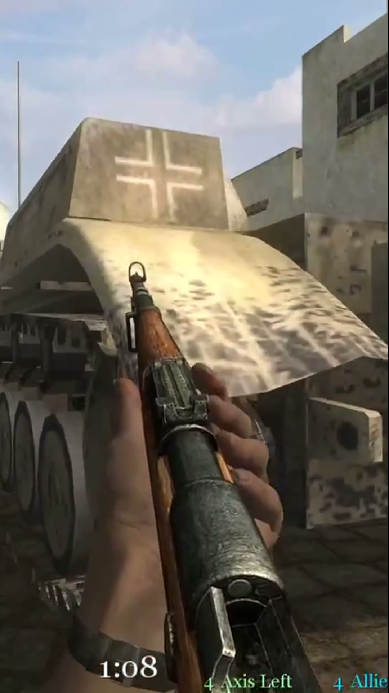

# Clip Anything

**Your 10-hour session has 10 great moments. Clip Anything finds them.**

A free, local, open-source command line tool. Long gameplay recording in, the top N vertical (9:16) highlight clips out, with word-synced captions when there is speech and a `report.json` that shows why each moment was picked. It scores moments by **action** (audio bursts, visual motion, scene cuts), so it works on recordings with zero commentary, on any game, with no account, no upload and no per-game profile.




```
uvx clip-anything gameplay.mp4
```

That is the whole workflow. Ten clips land in `./clips/` with a report next to them.

## Install

Needs Python 3.11+ and `ffmpeg` + `ffprobe` on your PATH.

| | |
|---|---|
| Run without installing | `uvx clip-anything gameplay.mp4` |
| Install as a tool | `pipx install clip-anything` or `uv tool install clip-anything` |
| With captions (faster-whisper) | `pipx install 'clip-anything[captions]'` |
| ffmpeg | macOS `brew install ffmpeg`, Debian/Ubuntu `sudo apt install ffmpeg`, Windows `winget install Gyan.FFmpeg` |

If ffmpeg is missing the tool exits with code 3 and prints the install line for your OS.

macOS note: the stock Homebrew `ffmpeg` formula has no `libass`, which burned-in captions need. Clip Anything looks for an `ffmpeg-full` build on your PATH and prefers it; without one, captions are still written as a sidecar `.ass` file next to each clip and everything else works.

## Usage

```
clip-anything <video> [options]
```

| Option | Default | What it does |
|---|---|---|
| `--count, -n` | 10 | Maximum clips to produce. Fewer come back when fewer moments clear the floor; there are no filler clips |
| `--min` / `--max` | 15 / 45 | Clip length bounds in seconds |
| `--out, -o` | `./clips` | Output folder |
| `--crop` | `follow` | `follow` pans the 9:16 crop with the action; `center` is a static centre crop |
| `--facecam` | `auto` | Detect a static webcam corner and stack it above the gameplay; `off` disables |
| `--no-captions` | | Never burn captions (captions are on by default when speech is found and the extra is installed) |
| `--whisper-model` | `base.en` | Whisper size for captions: `tiny.en`, `base.en`, `small`, ... |
| `--yes, -y` | | Allow the one-time Whisper model download without the prompt |
| `--speech-rank` | | Transcribe the top 3N candidates and let excitement words re-rank them (slower) |
| `--vision` | off | Re-rank the top clips and give them titles with a local Ollama vision model (see below) |
| `--min-score` | 0.5 | Action bar 0..1 that every clip must clear (audio and motion measured against fixed real-footage levels); `0` ranks the file against itself |
| `--config` | | TOML file with weights and settings (see below) |
| `--dry-run` | | Write `report.json` only: what would be clipped and why, no rendering |
| `--json` | | Print the report to stdout (progress goes to stderr) |
| `--no-cache` | | Ignore the cached analysis signals |
| `--force` | | Overwrite clips that already exist |
| `--workers` | cores / 4 | Parallel renders |

Exit codes: `0` ok, `1` nothing rendered, `2` bad input, `3` ffmpeg missing.

Output: `clips/<stem>_01_<mm-ss>.mp4` ... (1080x1920 H.264 + AAC, faststart) and `clips/report.json` with each clip's start, end, score, per-signal breakdown, crop keyframes, captions and every warning the run produced.

## How it works

1. **Probe.** ffprobe reads the file; variable frame rate, HEVC, HDR and rotated sources are handled. The full-resolution file is decoded exactly once per rendered clip; analysis runs on a 16 kHz mono audio stream and a 320 px / 5 fps grey proxy, both streamed from ffmpeg without writing temp files.
2. **Audio signals** per 0.5 s: RMS, spectral-flux onsets (gunshots, explosions, hits), and loudness against a rolling 60 s baseline, so constant music, radio or engine noise does not flatten the signal.
3. **Visual signals** per 0.5 s: motion energy, scene cuts, flashes, and the centre of motion mass that the crop will follow. Static cards (lobby, menu, loading screen) are detected and penalised.
4. **Scoring.** Signals are robust-normalised (rolling median / MAD), gated for informativeness, then mixed: a weighted mean, the strongest single signal, and an agreement term that rewards audio and motion rising together, so a lone loud menu sound cannot win alone. Peaks are picked, each becomes a 15-45 s window with the build-up before the peak (60 / 40), snapped to a quiet point or a cut, and overlapping windows are de-duplicated.
5. **Speech (optional).** If the `captions` extra is installed and speech is present, faster-whisper transcribes the chosen clips, excitement words add a bonus, and word-synced captions are burned in. Recordings with no speech skip this entirely.
6. **Facecam (optional).** A static webcam region in a corner is detected and stacked above the gameplay.
7. **Render.** One ffmpeg pass per clip: an action-following 9:16 crop with smoothed panning, HDR tone-mapped to SDR, fades, libx264 `veryfast` CRF 20, AAC.

Analysis signals are cached next to the video in `.clipanything/<id>/` so a re-run with different weights or counts takes seconds.

Measured on an M1 Max laptop: analysis takes about 25-55 seconds per hour of 480p-1080p30 input (decode-bound; 1080p60 is roughly 100 s/hour), and each 17 s 720p clip renders in about 3 s. A 1-hour file: analysis in well under a minute, cached re-runs in a few seconds.

## How it differs from transcript-first clippers

Most automatic clipping tools, hosted and open source, pick moments from the **transcript**: they look for a complete sentence, a punchline or a keyword, then cut around the speech. That works for podcasts and talking-head streams, and it fails on gameplay: a silent clutch, a crash, a last-second goal or a boss kill with music over it has no transcript to find. Tools that do detect game action usually do it with per-game detectors (kill-feed OCR, HUD templates, trained models for a list of supported titles), so a game that is not on the list, or that came out this week, gets a worse fallback or nothing.

Clip Anything scores **what happened**, not what was said:

- Action signals first (audio onsets, loudness over baseline, motion, cuts). Speech is a bonus weight, never a requirement.
- Game-agnostic by construction. There is no profile, no HUD template, no model trained on one game. It works on day one for any game, GTA 6 included, because it never needs to know which game it is looking at.
- Build-up included. Every clip starts before the peak and ends at a quiet point, so the moment reads as a story and not just the final frame.
- Local and private. Nothing is uploaded, there is no account, no credit meter, no watermark, no expiry. The only network use is the optional, one-time Whisper model download, which asks first.
- Honest output. `--count` is a maximum: if a quiet session only has four real moments you get four clips, and `report.json` tells you why.

Transcript-first tools remain the better choice when the content *is* the talking. Clip Anything is for the footage where the action speaks.

## Optional: local vision re-rank with Ollama

If [Ollama](https://ollama.com) is running on your machine with a vision model (`ollama pull qwen3-vl:4b`, or `gemma3:4b`, `minicpm-v`, `moondream`), `--vision` sends 4 small frames from each candidate clip to it and asks for a clip-worthiness score and a 4-6 word title. The final score becomes 0.7 action + 0.3 vision; titles land in the report and in the file names. Only `127.0.0.1:11434` is ever contacted. If Ollama is not running, no vision model is installed, or the model times out or answers badly, the run continues with the action-only order and leaves one warning line. Pick a model explicitly with `[vision] model = "..."` in the config.

The vision pass is not yet tuned or measured on real footage: treat it as an experiment, and read `report.json` before trusting a re-ordered list.

## Config file

Every weight and threshold lives in a TOML file. Copy [`clip-anything.toml`](clip-anything.toml) (the defaults, commented), edit, and pass `--config my.toml`. Command line flags override the file; the file overrides the built-in defaults.

```toml
[clips]
count = 10
min_s = 15.0
max_s = 45.0

[scoring]
w_loud = 1.0      # loudness above the rolling 60 s baseline
w_onset = 0.8     # spectral-flux onset sharpness (gunshots, explosions)
w_motion = 0.8    # visual motion on the proxy
w_agree = 0.4     # audio AND motion rising together
w_card = 0.8      # penalty for static cards (lobby, menu, loading)
min_score = 0.2     # relative floor: nothing below max(this, 0.35 x best) is returned
min_evidence = 0.5  # absolute action bar (--min-score): audio AND motion vs real-footage levels
lead_frac = 0.6   # share of the clip before the peak (build-up)

[layout]
crop = "follow"   # or "center"
facecam = "auto"  # or "off"

[speech]
captions = true
model = "base.en"

[vision]
enabled = false
```

### Default weights and the action bar

The defaults above were tuned on two public-licence recordings with hand-labelled moments: a 40-minute Call of Duty 2 multiplayer match (720p30, 19 labelled spans) and a 74-minute Persona 3 opening (480p60, 33 labelled spans, a turn-based RPG with almost no bursty action). Two mechanisms do most of the work:

- **Static-card penalty** (`w_card`): a window whose proxy frames are nearly still and full of text strokes (lobby, menu, loading, title card) is multiplied by `1 - 0.8 * card`. Loud menu sounds do not rescue it.
- **Action bar** (`min_evidence`, `--min-score`): every candidate is measured against fixed levels taken from real footage, not against the rest of the file. Audio must be sharp *and* loud (onset plus dB over the rolling baseline) and the picture must show sustained whole-frame motion around the peak. A candidate needs both; one group alone never clears the bar. Below the bar nothing is returned, which is why `--count` is a maximum. `--min-score 0` turns the bar off and ranks the file against itself.

Measured with `scripts/eval.py` (M1 Max, 2026-11-12):

| Recording | Asked | Returned | Duds (menu / text / idle) | Precision@10 |
|---|---|---|---|---|
| Call of Duty 2, 40 min | 10 | 10 | 1 (a round-start text card with loud onsets and seven cuts) | 0.80 |
| Persona 3, 74 min | 10 | 5 | 0 (all five are Tartarus battles) | 5 of 5 returned are real |

Before tuning the same files gave 3 and 8 duds in the top 10. Known misses: a cutscene explosion with music but no audio onset stays below the bar (by design, it has no audio evidence), and 45-second windows in a turn-based game sometimes include a result screen. Analysis alone (no render) ran at 26-47 seconds per hour of footage on these two files; a 3-hour file peaked at 384 MiB of RSS.

## Library use

The CLI is a thin wrapper; the pipeline is a plain library with no global state, so it can run inside your own script or a service.

```python
from clip_anything.config import Options
from clip_anything.pipeline import run

report = run("gameplay.mp4", Options.from_layers({"clips": {"count": 5}}))
for clip in report.ok_clips:
    print(clip.rank, clip.start, clip.end, clip.title, clip.path)
```

`run(video, options, on_event=..., cancel=...)` emits progress events instead of printing and returns the same `Report` that becomes `report.json`.

## Roadmap

- Window shaping for turn-based games (end a clip before the result screen) and a bar calibrated on more than two games
- Faster analysis on 1080p60 sources (hardware decode for the proxy)
- Hosted version for people who do not want to run anything locally
- Direct posting to TikTok, YouTube Shorts and Reels
- A learned scorer trained on which clips people keep
- Resumable analysis for very long (10 h+) recordings

See [CHANGELOG.md](CHANGELOG.md) for what shipped.

## Development

```
uv venv --python 3.11 && uv pip install -e '.[dev,captions]'
python scripts/make_test_video.py        # 3-min synthetic video with known bursts
pytest && ruff check .
```

The synthetic video has six injected audio bursts and four motion bursts; the end-to-end test asserts that the top six clips contain all six bursts with build-up before each.

## About

Clip Anything is a free, non-commercial passion project by an independent developer, shipped under [Ship at Midnight](https://shipatmidnight.dev). No telemetry, no accounts, nothing phones home.

Game names appear only to describe what a recording contains. Clip Anything is not affiliated with or endorsed by any game publisher.

MIT, see [LICENSE](LICENSE). Third-party components are listed in [NOTICE](NOTICE).
