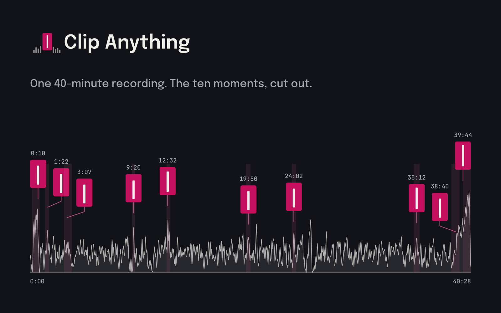

<p align="center"></p>

**Give it a long gameplay recording. It finds the best moments and cuts them into vertical clips for TikTok, Shorts and Reels. Free, open source, runs on your own computer.**




No account, no upload, no watermark. You type one line, wait a minute or two, and a folder called `clips` appears with the clips and a `report.json` that says why each one was picked. You do not need Claude, ChatGPT or any AI assistant to use it.

## Get it

### Windows

1. Open PowerShell (press Start, type `PowerShell`, press Enter).
2. Paste these two lines, one at a time, and press Enter after each:
   ```powershell
   winget install astral-sh.uv
   winget install Gyan.FFmpeg
   ```
3. Close PowerShell and open it again so it finds the new programs. Then paste:
   ```powershell
   uvx clip-anything "C:\Users\you\Videos\my-session.mp4"
   ```

### Mac

1. Open Terminal (press Cmd+Space, type `Terminal`, press Enter).
2. Paste this and press Enter (if it says `brew` is not found, install [Homebrew](https://brew.sh) first):
   ```bash
   brew install uv ffmpeg
   ```
3. Then paste:
   ```bash
   uvx clip-anything ~/Videos/my-session.mp4
   ```

### No terminal?

A desktop app for Windows and Mac is coming on the [Releases page](https://github.com/shreyassaw5394/clip-anything/releases). Download, open, drop a recording on it.

<details>
<summary>Before Nov 15 (package not on PyPI yet)</summary>

Until the package is published, run it straight from GitHub. Same thing, longer line:

```
uvx --from git+https://github.com/shreyassaw5394/clip-anything clip-anything my-session.mp4
```

Everywhere this page says `uvx clip-anything`, use that longer form instead.
</details>

Linux, pipx, captions, and other ways to install are in [docs/reference.md](docs/reference.md#install).

## Use it

Every scenario below is the same idea: get the recording onto your computer, run one line on it, open the `clips` folder. No AI assistant is involved.

The first run downloads the tool (about a minute). After that it starts right away. While it works you see a progress bar for each step, then a table like this, then the folder path:

```
 #   time          len   score   signals                   file
 1   12:33-12:51   18s    0.57   onset=1.00 motion=0.26    match_01_12-33.mp4
 2   40:03-40:20   16s    0.56   agree=0.84 motion=0.88    match_02_40-03.mp4
2/2 clips -> /Users/you/Videos/clips  (analysis 41s, render 7s)
```

### PS5 or Xbox

1. Get your clips off the console. PS5: plug in a USB drive, go to Media Gallery, select the clips, Copy to USB Drive; or share them to the PS App and save to your phone. Xbox: in the Xbox app on PC, go to Captures and download them, or turn on OneDrive upload in the console's Capture settings.
2. Put all the files in one folder on your computer, for example `C:\Users\you\Videos\ps5` or `~/Videos/ps5`.
3. Run it on the folder:
   ```
   uvx clip-anything ~/Videos/ps5
   ```
4. Console clips are short, so each file is treated as one candidate and the tool ranks them. If a file is a long full-session recording, it searches inside it.
5. Open the `clips` folder that appears where you ran the command.

### PC recording (OBS, ShadowPlay, Game Bar, Steam)

1. Find the recording. OBS: the folder set under Settings, Output, Recording Path (often `Videos`). ShadowPlay: `Videos\<game name>`. Game Bar: `Videos\Captures`. Steam: open Recordings & Screenshots, make a clip and Export it as MP4 (the raw Steam folder is not a video file).
2. Run it on the file:
   ```
   uvx clip-anything "C:\Users\you\Videos\Valorant\2026-11-12 21-04-33.mkv"
   ```
   Tip: type `uvx clip-anything ` and drag the file into the window to fill in the path.
3. Wait. A one-hour 1080p30 recording takes about a minute to analyse, plus a few seconds per clip to render.
4. Open `clips` in the folder you ran the command from.

### A stream VOD you downloaded (Twitch, YouTube, Kick)

1. Download the VOD with the tool you already use (Twitch's own Download button on your own VODs, or any downloader you trust). You end up with an `.mp4` or `.mkv`.
2. Run it:
   ```
   uvx clip-anything ~/Downloads/stream-2026-11-11.mp4
   ```
3. If your webcam is in a corner of the stream, the tool spots it and stacks it above the gameplay in the clip. If you talk on stream, see "captions" below.
4. Open `clips`.

### Phone screen recordings

1. Send the recordings to your computer (AirDrop, cable, Google Photos download).
2. Put them in one folder and run it on the folder:
   ```
   uvx clip-anything ~/Downloads/phone-recordings
   ```
3. Portrait recordings are already vertical, so the crop does little; landscape ones get cropped to follow the action.
4. Open `clips`.

### Change what it makes

One flag each. Add it to the end of the command.

- Only 5 clips: `--count 5`
- Clips too short or too long: `--min 20 --max 60` (seconds)
- It picked a menu or loading screen: `--min-score 0.6` (a higher bar; the default is 0.5)
- It found nothing, or you want more: `--min-score 0.3`, or `--min-score 0` to rank the file against itself
- No captions: `--no-captions`
- Captions when someone talks: install the bigger version once, `uvx --from "clip-anything[captions]" clip-anything my-session.mp4`. The first run asks before downloading a 145 MB speech model; answer `y`.
- Keep the picture still instead of following the action: `--crop center`
- Run it again with different flags: analysis is saved next to the video, so a second run takes seconds. Add `--force` to overwrite clips from the last run.

### A folder of many sessions

A folder is treated as one session. If you have several nights of footage, keep one folder per night and run once per folder with its own output name:

```
uvx clip-anything ~/Videos/monday --out clips-monday
uvx clip-anything ~/Videos/tuesday --out clips-tuesday
```

The full list of flags is in [docs/reference.md](docs/reference.md#all-options).

## What it works on

- `.mp4 .mkv .mov .m4v .ts .m2ts .mts .webm .avi .flv .wmv`
- One file, several files, or a folder of files
- Any game. There is no list of supported titles and nothing to set up per game.
- Recordings with no commentary at all
- Variable frame rate, HEVC, HDR and rotated sources
- Mac, Linux and Windows (Windows is less tested; see [docs/reference.md](docs/reference.md#known-limits))

## What's on by default

- Captions, word by word, when someone talks (needs the captions install above; recordings with no speech skip this)
- Facecam stack: a webcam in a corner is detected and placed above the gameplay
- The 9:16 crop follows the action instead of staying centred
- A `report.json` next to the clips with the time, score and reason for each one

Want AI titles and smarter picks? Run `clip-anything setup`, then add `--ai`. Local Ollama by default, or your own OpenAI/Anthropic key; see [docs/ai-mode.md](docs/ai-mode.md).

## How it picks moments

It listens for sudden loud sounds (shots, explosions, hits, shouting) and loudness jumps over what the recording sounded like a minute earlier. It watches for motion across the whole frame, scene cuts and flashes. A moment needs both the sound and the picture to spike; a loud menu sound on a still screen does not count. Each clip starts a bit before the peak so you see the build-up, and ends at a quiet point. Details and measured numbers are in [docs/benchmark.md](docs/benchmark.md).

## Compared with other clippers

- Many clippers find moments in the transcript (a sentence, a joke, a keyword). That works for talking streams and misses silent plays. Clip Anything scores the action and treats speech as a bonus.
- Tools that detect game action usually do it per game (kill feeds, HUD templates, trained models for a list of titles). Clip Anything has no per-game profile, so a game released this week works the same as an old one.
- It runs on your machine with no account, credit meter or expiry. If a quiet session only has four real moments you get four clips, and the report says why.

## Use it with an AI editor

You do not need one. If you already use one, it can run the tool for you and explain the picks.

**Claude Code**
```
/plugin marketplace add shreyassaw5394/clip-anything
/plugin install clip-anything@clip-anything
```
Then say "make 5 shorts from ~/Videos/last-night.mkv". The skill previews the picks before rendering and explains each one from `report.json`.

**Cursor**
Copy [`.cursor/skills/clip-anything/`](.cursor/skills/clip-anything/) into your project (or into `~/.cursor/skills/` for every project). Cursor finds `SKILL.md` on its own; type `/clip-anything` in Agent chat to call it directly. The short rule in [`.cursor/rules/clip-anything.mdc`](.cursor/rules/clip-anything.mdc) points the agent at it when you ask for clips.

**ChatGPT, Copilot, or anything else**
Paste the "Change what it makes" list above and the one-line command into the chat and ask it to write the command for your file. Then run that line yourself in PowerShell or Terminal.

## Privacy

Nothing leaves your computer. The recording is read and the clips are written on your own disk. There is no account, no telemetry and nothing phones home. The only network use is the optional, one-time download of the speech model for captions, which asks first. The optional `--vision` pass talks only to an Ollama server on your own machine.

## Problems?

- Ask on [Discord](https://discord.gg/s8wj7tBAM).
- Ran it on a real recording? Fill in the three-question [Tried it](https://github.com/shreyassaw5394/clip-anything/issues/new?template=tried-it.md) issue. It is the most useful thing you can send.
- Something broke: open a [bug](https://github.com/shreyassaw5394/clip-anything/issues/new?template=bug.md). Security problems go to [SECURITY.md](SECURITY.md).

## About

Clip Anything is a free, non-commercial passion project by an independent developer, shipped under [Ship at Midnight](https://shipatmidnight.dev). MIT licence, see [LICENSE](LICENSE); third-party components are in [NOTICE](NOTICE). Provided as is, without warranty.

Clip choices are automated and can be wrong. Captions come from speech recognition and `--vision` titles from a local model; both can mishear or misdescribe, so check them before you post. Game names appear only to describe what a recording contains; they belong to their owners, and Clip Anything is not affiliated with any game publisher.

More: [docs/reference.md](docs/reference.md) (every option, config file, library use, limits, roadmap) and [docs/benchmark.md](docs/benchmark.md) (how the defaults were tuned and what was measured). Changes: [CHANGELOG.md](CHANGELOG.md).
